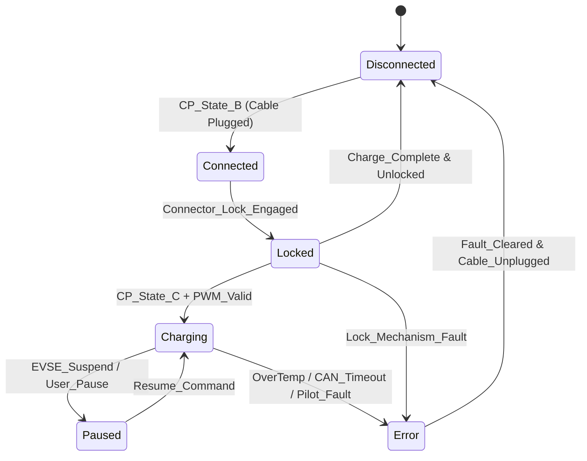
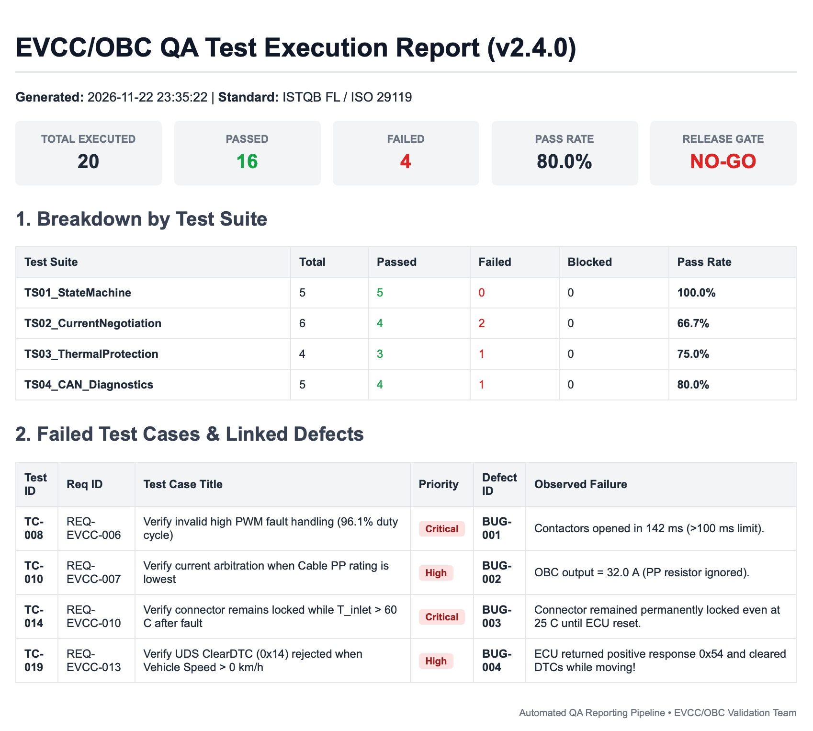

# EV Charging Controller (EVCC/OBC) – QA Test Campaign

## Project Overview

This repository demonstrates an end-to-end **Software Testing Life Cycle (STLC)** campaign for an **Electric Vehicle Communication Controller (EVCC)** and **On-Board Charger (OBC)** module (`SW Release v2.4.0`).

The project is structured according to **ISTQB Foundation Level** principles and **ISO/IEC/IEEE 29119** test documentation standards, showcasing:
* **Static Testing:** Requirements review and ambiguity detection (Shift-Left approach).
* **Risk-Based Test Planning:** Product risk analysis, entry/exit criteria, and test environment setup.
* **Black-Box Test Design:** Equivalence Partitioning (EP), Boundary Value Analysis (BVA), Decision Tables, and State Transition Testing.
* **Defect Management:** Full bug lifecycle tracking with CAN/UDS diagnostic evidence, severity/priority triage, retesting, and regression verification.
* **Test Reporting & Automation:** Progress reports, final Go/No-Go summary report, and a Python-based automated HTML/Email reporting pipeline.

---

## System Under Test (SUT) Architecture

The EVCC/OBC module manages the AC/DC charging session between the Electric Vehicle Supply Equipment (EVSE) and the High-Voltage Battery Management System (BMS).

---

## Repository Structure

| Directory | Description | Key Artifacts |
| :--- | :--- | :--- |
| [`01_requirements/`](./01_requirements) | System Requirements Specification (SRS) and static review findings. | `EVCC_SRS_v1.2.md`, `static_review_report.md` |
| [`02_test_plan/`](./02_test_plan) | Master Test Plan including scope, risk matrix, and exit criteria. | `MASTER_TEST_PLAN.md` |
| [`03_test_cases/`](./03_test_cases) | Detailed black-box test suites and Requirements Traceability Matrix. | `test_cases.csv`, `RTM.md`, `test_design_techniques.md` |
| [`04_defect_reports/`](./04_defect_reports) | Defect report template and documented bugs with CAN/UDS logs. | `defect_log.md`, `defect_template.md` |
| [`05_test_reports/`](./05_test_reports) | Weekly test progress reports and final release recommendation. | `progress_report_w1.md`, `TEST_SUMMARY_REPORT.md` |
| [`reporting_automation/`](./reporting_automation) | Python tool parsing execution results into HTML reports & SMTP alerts. | `generate_report.py`, `sample_report.html` |

---

## Campaign Execution Summary (Release v2.4.0)

* **Total Requirements Covered:** 14 / 14 (100% Traceability)
* **Total Test Cases Executed:** 20
* **Pass Rate:** 80.0% (16 Passed, 4 Failed, 0 Blocked)
* **Critical Open Defects:** 1 (`BUG-003`: Connector unlock failure on emergency thermal shutdown)
* **Final Release Decision:** **NO-GO** (Pending hotfix `v2.4.2` and regression cycle)

---

## Automated HTML Report Preview

